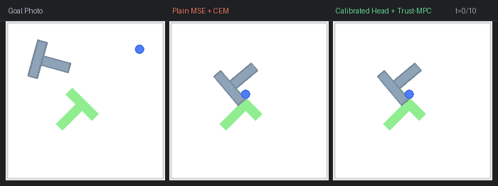
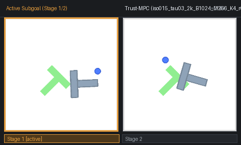
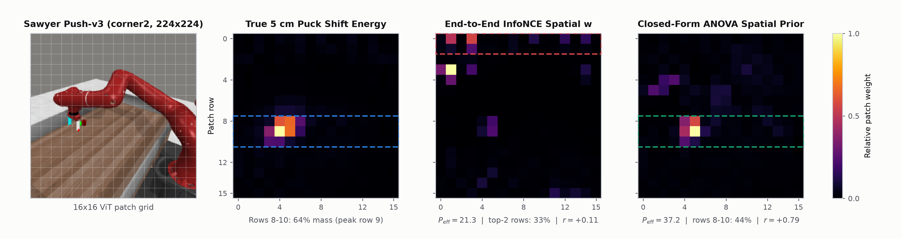

# JEPA-Planning

Planning with frozen joint-embedding predictive world models (DINO-WM) under
nuisance-perturbed visual goals. Without modifying the pretrained world model,
this repository studies how goal representations, metric geometry, and
closed-loop trajectory optimization interact across 2D planar pushing (`PushT`)
and 3D articulated manipulation (`Meta-World Sawyer Push-v3`).

## Unified Problem & Architecture

When a frozen DINO-WM plans toward a single RGB goal photograph using plain
patch-feature MSE, visual nuisance (an unrelated blue pusher in PushT or a
repositioned 7-DoF Sawyer gripper in Meta-World Push) dominates the terminal
cost and pulls the planner off the true object goal. This project integrates
four complementary research tracks around the frozen backbone:

1. **Multi-Goal Prototype Saturation** (`code/jepa_planning/pusht_multi_goal.py`,
   `code/jepa_planning/goal_costs.py`) — Averages equivalent goal photographs
   sharing the same object pose across different effector positions. On PushT,
   4-goal averaging cuts fixed-bank regret from `5.309` to `3.270` and
   closed-loop final error from `43.932` to `30.786 px` across five seed banks,
   while scaling up to `K = 32` shows `K = 4` is the practical saturation knee.
2. **Spectral-Isotropy & `k`-Fantope Linear Goal Heads**
   (`code/jepa_planning/linear_head.py`, `code/jepa_planning/trust_mpc.py`,
   `code/experiments/train_calibrated_heads.py`) — Fits a single trace-normalized
   linear projection $L \in \mathbb{R}^{r \times 384}$ ($\|L\|_F = 1$) used only
   inside the planning cost $J_L(\hat z, g) = \mathrm{mean}_p \|L(\hat z_p - g_p)\|^2$.
   Diagnosing why large-budget unregularized InfoNCE (`B = 1024`) collapses to
   effective rank `1.39`, we add log-det row-isotropy regularization and exact
   `k`-Fantope spectral projection to keep the full object-pose subspace active.
3. **IIA-Safe Calibrated, Quasimetric & Visual Waypoint Objectives**
   (`code/jepa_planning/calibrated_objectives.py`,
   `code/jepa_planning/quasimetric_cost.py`, `code/jepa_planning/temporal_cost.py`,
   `code/jepa_planning/waypoint_mpc.py`) — Unifies anchor-calibrated and
   dense-horizon head scoring, studies temporal and Interval Quasimetric
   Embedding (IQE) step-distance costs, and introduces purely visual multi-stage
   waypoint chaining with latent arrival handoff and warm-start reset.
4. **Barrier-Certified Trust-MPC (2D PushT & 3D Meta-World Sawyer Push-v3)**
   (`code/jepa_planning/trust_mpc.py`, `code/jepa_planning/metaworld_planning.py`)
   — Preserves exact `2 * N` rollout-budget parity with standard CEM while
   certifying the elite mean against Jensen's inequality on non-convex contact
   barriers (dual-certifying the dominant directional mode on split) and
   gating post-peak drift via an explicit zero-displacement hold trajectory.

An **Interactive Visual World-Model Planning Studio** (`code/jepa_planning/studio.py`,
`code/scripts/run_planning_studio.py`) exposes live `16x16` patch-energy
heatmaps, 2D PushT drag-and-drop closed-loop duels, 2-stage visual waypoint
chains, and 3D Meta-World Sawyer `Push-v3` counterfactual inspection, paired
closed-loop duels, and side-by-side animated GIF export.

## Headline Capstone Results

Full held-out `test` tables, spectral diagnostics, failure-mode analyses, and
exact reproduction commands are documented in
[**`docs/unified_capstone_results.md`**](docs/unified_capstone_results.md).

| Domain & Protocol | Baseline (Plain MSE + Std CEM) | Unified Stack (Calibrated Head + Cert Trust-MPC) | Key Gain / Finding |
|---|---:|---:|---|
| **2D PushT Closed-Loop** (`N=24` test, `512` unrolls) | `25.89 px` (`IQM 19.44`, `54%` $\le 20\text{ px}$) | **`13.84 px`** (`IQM 10.46`, `79%` $\le 20\text{ px}$, `0.00 px` drift) | **`-46.5%`** vs. MSE, **`-57.7%`** vs. collapsed `B=1024` (`32.73 px`); `B=64` hits **`83%`** |
| **2D PushT Visual Waypoints** (`N=8` 2-stage, `1024` unrolls) | `50.0%` S1, `12.5%` handoff, `94.12 px` S2 | **`75.0%`** S1, **`37.5%`** handoff, **`70.89 px`** S2 | **`3x`** accurate latent handoff, zero privileged state |
| **3D Sawyer `Push-v3` Audit** (`N=72` test, `N=12` bank) | `0.056` top-1, `0.517` AUROC, `3.15 cm` ACT regret | **`0.500`** top-1, **`0.917`** AUROC, **`2.19 cm`** ACT regret | **`9x`** retrieval, **`42x`** `2 cm` sensitivity, **`-30.5%`** ACT regret via ANOVA prior |
| **3D Sawyer `Push-v3` Closed-Loop** (`N=12` test, `H=6`) | `4.47 cm` mean, `92%` $\le 5\text{ cm}$, `0%` $\le 3\text{ cm}$ | `6.89 cm` mean (`IQM 5.78`), **`17%` $\le 3\text{ cm}$** | Breaks MSE's `3 cm` precision ceiling while exposing free-space contact sparsity |

### Visual Showcases & Spatial Anatomy







## Repository Layout

```text
proposal/              Original proposal and presentation
docs/                  Research reports, method notes, and reproduction guides
code/jepa_planning/    Reusable modules (heads, Trust-MPC, quasimetric, waypoint, studio)
code/experiments/      Experiment entry points (PushT and Meta-World)
code/configs/          YAML task, goal-group, and planner configurations
code/scripts/          Setup, checkpoint download, figure generation, and Studio CLI
code/tests/            CPU unit and integration test suite
requirements/          Pinned dependency lockfile (project.lock)
third_party/           Pinned upstream facebookresearch/jepa-wms snapshot
```

## Environment & Checkpoints

Our reference world-model backbone is
[`facebookresearch/jepa-wms`](https://github.com/facebookresearch/jepa-wms) at
commit `13cf1d9c7e476f53c17714d2e0f1dc239a883ce0` (`third_party/jepa-wms/`).
Model checkpoints, datasets, and generated experiment outputs under `results/`
are excluded from version control.

One project-local `.venv` (Python 3.10.19, from `requirements/project.lock`)
serves both PushT and Meta-World Push:

```bash
bash code/scripts/setup_env.sh
.venv/bin/python code/scripts/download_checkpoint.py --env pusht
.venv/bin/python code/scripts/download_checkpoint.py --env metaworld
.venv/bin/python code/scripts/check_env.py
.venv/bin/python code/scripts/checkpoint_smoke.py --env pusht
MUJOCO_GL=glfw .venv/bin/python code/scripts/checkpoint_smoke.py --env metaworld
```

Use `MUJOCO_GL=glfw` on macOS and `MUJOCO_GL=egl` on headless Linux clusters.

## Quickstart Commands

### 1. Run Unit & Integration Tests (CPU)

```bash
MUJOCO_GL=glfw .venv/bin/python -m pytest -q
```

### 2. Generate Calibrated Goal Groups & Train Linear Heads

For 3D Meta-World Sawyer `Push-v3`, use `code/configs/metaworld_goal_groups_calibrated.yaml`
(which restricts the Sawyer mocap hand bank to the verified reachable box
`[-0.20, 0.20] x [0.58, 0.86] m` at `size=320`, `max_reach_error=0.03 m`):

```bash
# Render + encode Meta-World goal groups (train/val/test)
MUJOCO_GL=glfw .venv/bin/python code/experiments/make_goal_groups.py \
  --split train --config code/configs/metaworld_goal_groups_calibrated.yaml \
  --output results/metaworld_goal_groups_cal/train
.venv/bin/python code/experiments/encode_goal_groups.py \
  results/metaworld_goal_groups_cal/train --env metaworld --device mps

# Fit unregularized, spectral-isotropy, and k-Fantope heads with spectral audit
.venv/bin/python code/experiments/train_calibrated_heads.py \
  --train-groups results/pusht_goal_groups/train \
  --val-groups results/pusht_goal_groups/val \
  --regimes unregularized isotropy fantope \
  --budgets 64 256 1024 --hands 4 --ranks 32 \
  --device cpu --output results/pusht_calibrated_heads
```

### 3. Closed-Loop Trust-MPC Evaluation (2D PushT & 3D Meta-World)

```bash
# 2D PushT paired closed-loop evaluation (exact 2*N rollout parity)
.venv/bin/python code/experiments/run_pusht_trust_mpc.py \
  --groups results/pusht_goal_groups/test \
  --head-files results/pusht_calibrated_heads/heads/iso005_tau03_2k_B1024_M256_K4_r0.pt \
  --planners standard_cem trust_mpc_certified \
  --device mps --output results/pusht_trust_mpc_eval

# 3D Meta-World Sawyer Push-v3 paired closed-loop evaluation
MUJOCO_GL=glfw .venv/bin/python code/experiments/run_metaworld_trust_mpc.py \
  --groups results/metaworld_goal_groups_cal/test \
  --head-files results/metaworld_calibrated_heads/heads/iso005_tau03_2k_B640_M160_K4_r0.pt \
  --planners standard_cem trust_mpc \
  --goal-photos 1 4 --tasks 20 --replans 10 --horizon 4 \
  --device mps --output results/metaworld_trust_mpc_eval
```

### 4. Multi-Stage Visual Waypoint Manipulation (PushT)

```bash
.venv/bin/python code/experiments/run_pusht_waypoint_demo.py \
  --head-file results/pusht_calibrated_heads/heads/iso005_tau03_2k_B1024_M256_K4_r0.pt \
  --tasks 10 --replans 10 --arrival-ratio 0.35 \
  --device mps --output results/pusht_waypoint_demo
```

### 5. Publication Benchmark Figures

```bash
.venv/bin/python code/scripts/generate_benchmark_figures.py \
  --heads-dir results/pusht_calibrated_heads/heads \
  --closed-loop-json results/metaworld_trust_mpc_eval/summary.json \
  --spectral-audit results/pusht_calibrated_heads/spectral_audit.csv \
  --theme light --pdf --output results/figures
```

### 6. Interactive Visual World-Model Planning Studio & GIF Export

```bash
# Launch web studio (2D PushT + Waypoints + 3D Sawyer Push-v3) on http://127.0.0.1:8765
MUJOCO_GL=glfw .venv/bin/python code/scripts/run_planning_studio.py \
  --device mps --enable-metaworld \
  --heads-dir results/pusht_calibrated_heads \
  --metaworld-heads-dir results/metaworld_calibrated_heads

# Headless side-by-side duel GIF export (PushT or 3D Sawyer Push-v3)
.venv/bin/python code/scripts/run_planning_studio.py \
  --device mps --export-demo-gif results/pusht_duel.gif
MUJOCO_GL=glfw .venv/bin/python code/scripts/run_planning_studio.py \
  --device mps --export-metaworld-gif results/metaworld_duel.gif
```

## Documentation Index

See [`docs/README.md`](docs/README.md) for the complete index of experiment
reports, design notes, and reproduction instructions across all four tracks.

## Coding Requirements

All team-authored code follows these standards:

- **Documentation and readability:** Provide descriptive module docstrings,
  document assumptions and invariants near the code, and keep interfaces clean
  and self-documenting.
- **Design and portability:** Keep reusable logic in `code/jepa_planning/`,
  experiment orchestration in `code/experiments/`, and environment or figure
  utilities in `code/scripts/`. Avoid machine-specific hardcoded paths.
- **Unit tests and validation:** Pair substantive modules with fine-grained
  CPU unit tests in `code/tests/` covering nominal paths, boundary conditions,
  and failure cases.
- **Collaboration:** Record configs, checkpoints, splits, seeds, and metrics
  for every experiment; keep large generated artifacts and checkpoints outside
  Git.
