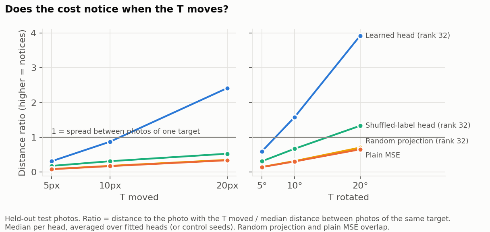
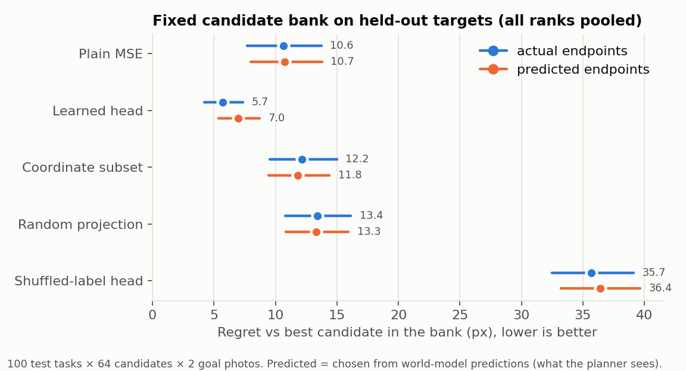
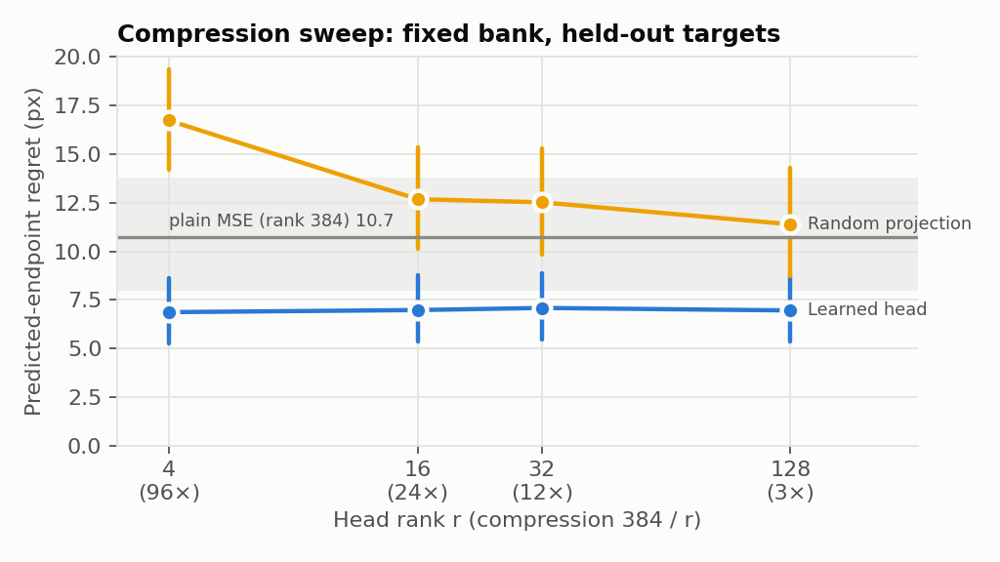
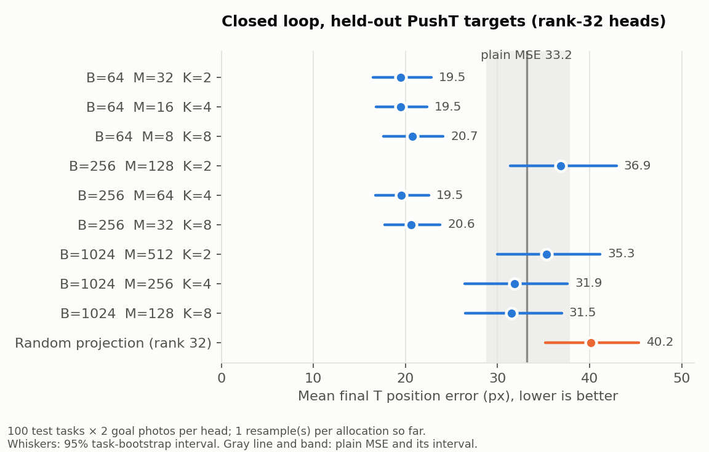

# PushT learned linear goal head: what was done and results so far

Status (2026-11-09): data, head training, the photo-level test and the fixed
candidate bank are **complete**. The closed-loop evaluation is **partly done**:
plain MSE, one resample of each of the 9 rank-32 allocations, and one
random-projection control. The rest runs overnight on a Mac (see
[Remaining work](#remaining-work)). The full plan is in
[`linear_head_plan.md`](linear_head_plan.md). PushT comes first, before the
proposal's Meta-World Push.

## The idea in one paragraph

The planner scores each candidate action sequence by how close the frozen
DINO-WM's predicted final features are to a **goal photo's** features (256
patches × 384 dims, mean squared distance). A PushT goal photo shows the T block
*and* the agent, but only the T's pose is the goal. Plain MSE also rewards
matching the agent's position, so equivalent goal photos give different plans.
The head is one matrix `L ∈ R^{r×384}` (r = 32 in the proposal), shared by all
patches, used only in the cost:

    J_L(A, g) = mean_i ||L (ẑ_i(A) − g_i)||²      (plain MSE: L = I / √384)

`L` is trained contrastively (InfoNCE): photos of the **same T pose with the
agent elsewhere** are pulled together, and photos of **different T poses** are
pushed apart. `||L||_F = 1` is restored after every step. The world model and its
rollouts are unchanged.

Research question (proposal §3): at a fixed photo budget **B = M × K**, is it
better to have more T poses (**M**) or more agent positions per pose (**K**)?
We also sweep the rank r (compression 384/r), which goes beyond the proposal.

## What was built

| Step | Code | Output |
|---|---|---|
| Goal groups: render T poses × agent positions with the jepa-wms PushT env | `jepa_planning/pusht_goal_groups.py`, `experiments/make_pusht_goal_groups.py` | `results/pusht_goal_groups/{train,val,test}` |
| Encode photos with the frozen encoder (fp16 cache) | `experiments/encode_goal_groups.py` | `features.pt` per split |
| Train heads: τ/lr grid on val per rank, 9 allocations × 3 resamples, shuffled-label heads, random/coordinate controls | `jepa_planning/linear_head.py`, `experiments/train_linear_head.py` | `results/pusht_linear_head_mac/rank{4,16,32,128}` |
| 6.1 Photo-level test (retrieval, AUROC, sensitivity) | `experiments/evaluate_linear_heads.py` | `.../test_eval/test.csv` |
| 6.2/6.3 Fixed candidate bank, actual and predicted endpoints | `jepa_planning/pusht_head_planning.py`, `experiments/run_pusht_head_bank.py` | `results/pusht_head_bank/{val,test}` |
| 6.4 Paired closed-loop CEM | `experiments/run_pusht_head_closed_loop.py`, `scripts/run_pusht_head_closed_loop_night.sh` | `results/pusht_head_closed_loop/test` |
| 6.5 Task-level bootstrap (IQM, 95% CIs, paired vs MSE) | `experiments/summarize_pusht_heads.py` | `summary.csv` |
| Figures in this report | `experiments/plot_pusht_head_results.py` | `docs/figures/` |

**Data.** Train / val / test: 512 / 64 / 100 T poses × 8 agent positions =
4096 / 512 / 800 photos. T poses are built like the closed-loop multi-goal
targets (random start, farthest endpoint of 128 random 2-chunk rollouts).
Agents come from a fixed bank of 64 positions split 32/16/16, so test agents
are never seen in training. 6.5–8.6% of photos were rejected because the agent
overlapped the T. Val/test also have photos with the T moved 5/10/20 px or
rotated 5/10/20°.

**Training.** 2000 steps, batch 64, 1 positive + 7 negatives per anchor, Adam.
τ ∈ {0.03, 0.1, 0.3} × lr ∈ {0.003, 0.01} chosen per rank on val (rank 4/16/32:
τ 0.3, lr 0.003; rank 128: τ 0.03, lr 0.01). Allocations B ∈ {64, 256, 1024},
K ∈ {2, 4, 8}. Every reported number below is on the **test** split, with no
refitting or retuning; val was used only for selection.

## Results

### 6.1 Photo level: the head keeps the T and drops the agent

All learned heads tell same-T pairs from different-T pairs (AUROC 1.000,
plain MSE 0.995). The sensitivity check verifies the head did not just collapse
everything: when the T moves, the head's distance grows far beyond the usual
spread between photos of one target. Plain MSE barely notices.



| Ratio (median) | shift 5 / 10 / 20 px | rotate 5 / 10 / 20° |
|---|---|---|
| Learned head, rank 32 | 0.31 / 0.87 / 2.42 | 0.59 / 1.58 / 3.93 |
| Shuffled-label head, rank 32 | 0.17 / 0.31 / 0.52 | 0.31 / 0.67 / 1.33 |
| Random projection, rank 32 | 0.08 / 0.17 / 0.35 | 0.14 / 0.31 / 0.70 |
| Plain MSE | 0.08 / 0.17 / 0.33 | 0.14 / 0.30 / 0.65 |

### 6.2/6.3 Fixed candidate bank: week-4 gate passes

Each test task has 64 shared action chunks, executed in the simulator. Each cost
picks one chunk for each of two equivalent goal photos. Regret is the chosen
chunk's T error minus the best chunk's. **Predicted** endpoints are what the
planner actually sees. The proposal's week-4 gate asks whether the head improves
decisions made from predicted features. It does.



- Learned heads: 7.0 px predicted regret vs 10.7 for plain MSE. Rank-32
  allocations, paired vs MSE: −2.6 to −4.3 px. The 95% CI excludes 0 for 8 of 9
  (B1024 M256 K4: [−5.7, +0.4]).
- Swapping goal photo 0 for photo 1 changes the chosen chunk in **26%** of
  tasks with plain MSE and **4–12%** with a head, so the agent's position
  matters much less.
- Controls: random projections (13.3) and coordinate subsets (11.8) are no
  better than MSE, and shuffled-label heads are far worse (36.4). The gain comes
  from what the head learned, not from compressing the features.



Compression barely matters for learned heads: rank 4 (96×) is as good as
rank 128 (3×). Random projections get worse as they compress more.

### 6.4 Closed loop: large gains at B ≤ 256, none yet at B = 1024

Paired CEM (4 replans × 2 iterations × 64 samples, 2-chunk horizon). Every
cost uses the same start states, the same random numbers and the same budget;
only the terminal cost changes. 100 test tasks × 2 goal photos per head.



| Rank 32, resample r0 | K = 2 | K = 4 | K = 8 |
|---|---:|---:|---:|
| B = 64 | **19.5** (−13.7 [−18.4, −9.2]) | **19.5** (−13.7 [−18.3, −9.4]) | **20.7** (−12.5 [−17.1, −8.1]) |
| B = 256 | 36.9 (+3.7 [−2.1, 9.6]) | **19.5** (−13.7 [−18.4, −9.2]) | **20.6** (−12.6 [−17.2, −8.1]) |
| B = 1024 | 35.4 (+2.2 [−3.5, 8.1]) | 31.9 (−1.3 [−7.2, 4.5]) | 31.5 |

Mean final T position error in px (paired difference vs plain MSE, 95% task
bootstrap). Plain MSE: **33.2 px**, success within 20 px 0.47. The good heads
reach about 0.63. Random rank-32 projection: 40.2 px.

How to read this, with caution:
- At B = 64 and most of B = 256, the head cuts final T error by ~40%, and the
  intervals are well away from zero.
- All three B = 1024 heads and B = 256 K = 2 are no better than MSE. The
  fixed bank also ranked the B = 1024 heads worst, though they still beat MSE
  there. One untested explanation: every allocation trains for the same 2000
  steps, so B = 1024 sees each photo fewer times. Equal steps per allocation is
  required by the proposal (Algorithm 1, step 3), so the main comparison keeps it.
- **Each cell is a single fit.** The proposal asks for 3 resamples per
  allocation. r1 and r2 are queued, so the M-vs-K question is still open.

## From the proposal vs. our additions

| From the proposal | Our choices / additions |
|---|---|
| Cost Eq. 3, `‖L‖_F = 1`, one 32×384 L shared by all patches | Rank sweep 4–128 (proposal fixes r = 32) |
| InfoNCE Eq. 4 with 1 positive + 7 negatives; renormalize; reject zero-norm updates; equal updates per allocation (Alg. 1) | τ/lr chosen by val AUROC (proposal gives no tuning rule) |
| B ∈ {64, 256, 1024} × K ∈ {2, 4, 8}; held-out targets and agents (Eq. 1, §3.2) | PushT instead of Meta-World Push, which comes next |
| Controls: plain distance, random projections, coordinate subset, shuffled labels (§5) | Photo-level AUROC and top-1 retrieval (6.1) |
| Regret and error to the photographed target, native success separately, planning time (Eq. 5) | 10/20/50 px thresholds as PushT stand-ins for 1/2/5 cm; pose success; combined error |
| Actual → predicted → closed loop; 100 tasks × 2 photos × 3 resamples; equal planner budgets (§5) | IQM alongside the mean |
| Task-level uncertainty keeping photos together (§5, ref. 12) | Sensitivity measured as a ratio at 5/10/20 px and degrees |
| "Move the object goal slightly" check; goal-photo intervention (§5) | |
| Week-4 gate on predicted features (§7) | |

Not done yet from the proposal: nonlinear head, VICReg / SIGReg losses,
coordinate-readout and object-mask comparisons, labelling-effort and compute-cost
reports, and Meta-World Push.

## Remaining work

1. Closed loop, in this order (`configs/pusht_head_closed_loop_order.txt`):
   rank-32 shuffled control, resamples r1/r2 of all 9 allocations, remaining
   rank-32 controls, then the val-best allocation at ranks 4/16/128. That is 59
   heads at ~55 min each on an M2. It runs overnight only:
   `caffeinate -dimsu bash code/scripts/run_pusht_head_closed_loop_night.sh`
   (resumable; finished heads are skipped). On a GPU cluster the heads can be
   split across jobs with `--heads`.
2. Check the B = 1024 result with a separate diagnostic, e.g. longer training
   of those heads. The main comparison keeps equal steps for every allocation,
   as Algorithm 1 requires.
3. Meta-World Push, the proposal's environment: the code exists
   (`goal_groups.py`, `make_goal_groups.py`) but has not yet run in the
   simulator.

## Reproduce (repository root, Mac)

```bash
bash code/scripts/run_pusht_linear_head_local.sh            # data, encoding, head training
.venv/bin/python code/experiments/evaluate_linear_heads.py --runs results/pusht_linear_head_mac/rank{4,16,32,128} \
  --test results/pusht_goal_groups/test --output results/pusht_linear_head_mac/test_eval --device mps
for s in val test; do .venv/bin/python code/experiments/run_pusht_head_bank.py --split $s \
  --runs results/pusht_linear_head_mac/rank{4,16,32,128} --output results/pusht_head_bank/$s --device mps; done
caffeinate -dimsu bash code/scripts/run_pusht_head_closed_loop_night.sh
.venv/bin/python code/experiments/summarize_pusht_heads.py --kind closed-loop \
  --input results/pusht_head_closed_loop/test --output results/pusht_head_closed_loop/test/summary.csv
.venv/bin/python code/experiments/plot_pusht_head_results.py
```

Generated results are git-ignored. This report keeps the numbers.
