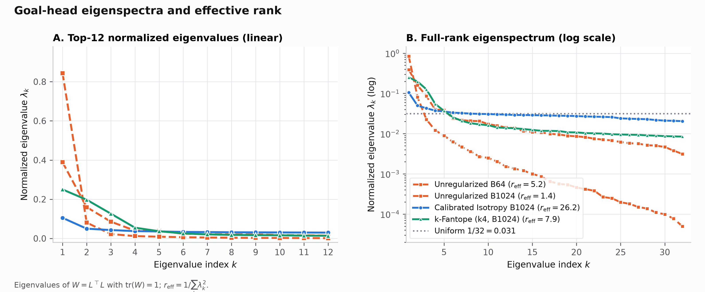
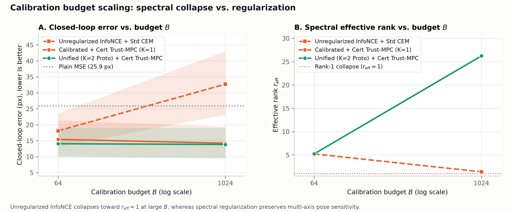
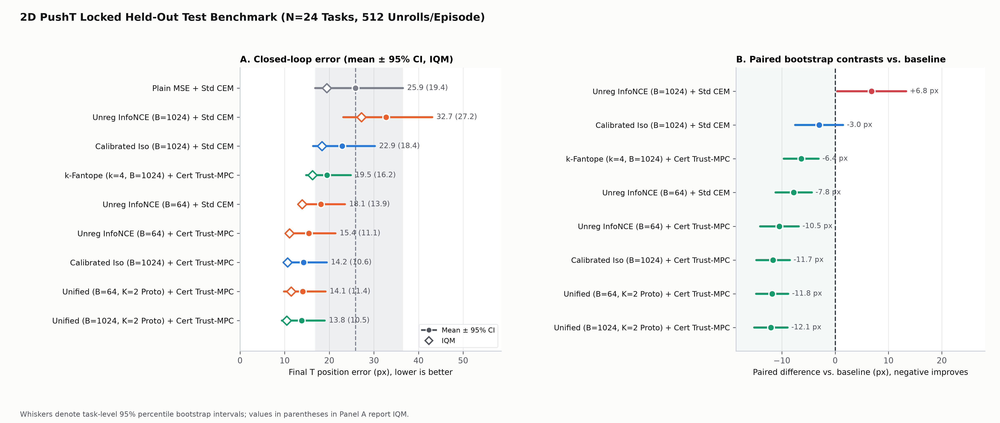
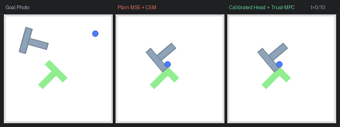
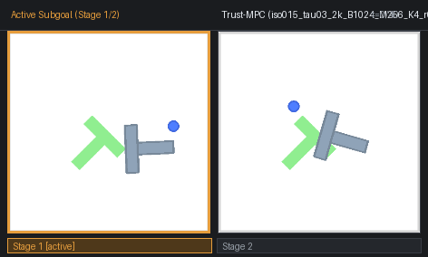
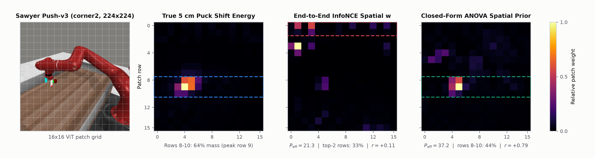
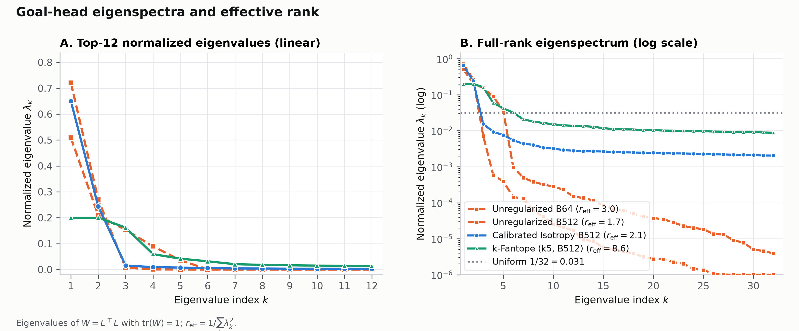
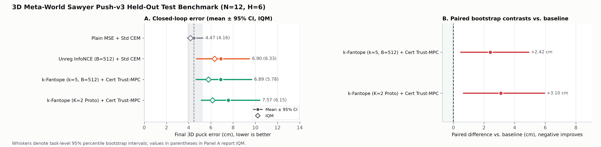
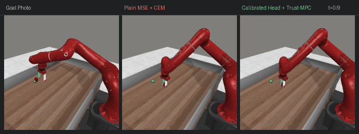

# Unified Capstone Results: Calibrated Goal Geometry and Certified Trust-MPC for Frozen World Models

This report synthesizes all four research tracks in `JEPA-Planning` and documents locked held-out `test` evaluations across 2D planar pushing (`PushT`), zero-privileged-state multi-stage visual waypoint chaining, and 3D articulated manipulation (`Meta-World Sawyer Push-v3`) on frozen [`facebookresearch/jepa-wms`](https://github.com/facebookresearch/jepa-wms) (DINO-WM) checkpoints.

---

## 1. Unified Research Synthesis Across All Four Tracks

Planning directly in frozen DINO-WM patch-feature space via plain mean squared error (MSE) fails when a goal photograph contains an unrelated effector pose (a repositioned blue pusher in PushT or a 7-DoF Sawyer arm/gripper in Meta-World Push). Across four tracks, we compose a single zero-privileged-state planning stack that leaves the pretrained world model completely frozen:

1. **Track 1 — Multi-Goal Prototype Saturation** (`code/jepa_planning/pusht_multi_goal.py`, `code/jepa_planning/goal_costs.py`, [`pusht_multi_goal.md`](pusht_multi_goal.md), [`pusht_goal_count_saturation.md`](pusht_goal_count_saturation.md)):
   Averaging $K$ equivalent goal photographs of the same target object pose across independent effector positions cancels effector nuisance variance as $1/K$. With a learned linear head $L$, `projected_multi_goal_distance` scores candidate rollouts against the projected multi-goal prototype at zero extra rollout cost, establishing $K = 2\text{--}4$ as the practical knee.
2. **Track 2 — Contrastive Linear Goal Heads & Spectral Regularization** (`code/jepa_planning/linear_head.py`, `code/jepa_planning/trust_mpc.py`, `code/experiments/train_calibrated_heads.py`, [`pusht_linear_head.md`](pusht_linear_head.md)):
   We learn a single trace-normalized linear projection $L \in \mathbb{R}^{r \times 384}$ ($\|L\|_F = 1$) defining the patch metric $D_L(\hat z, g) = \mathrm{mean}_p \|L(\hat z_p - g_p)\|_2^2$. Diagnosing severe rank-1 spectral collapse in unregularized InfoNCE at large calibration budgets ($B = M \times K$), we introduce log-det row-isotropy regularization ($-\frac{\beta}{r}\log\det(r L L^\top + \varepsilon I)$) and exact $k$-Fantope spectral projection on $W = L^\top L$ to preserve multi-axis object-pose sensitivity.
3. **Track 3 — IIA-Safe Calibrated, Quasimetric & Multi-Stage Visual Waypoint Objectives** (`code/jepa_planning/calibrated_objectives.py`, `code/jepa_planning/quasimetric_cost.py`, `code/jepa_planning/temporal_cost.py`, `code/jepa_planning/waypoint_mpc.py`, [`pusht_temporal_cost.md`](pusht_temporal_cost.md), [`pusht_quasimetric_cost.md`](pusht_quasimetric_cost.md)):
   Unifies positive-scale-invariant, IIA-preserving goal scoring (`calibrated_objectives.py`), temporal and Interval Quasimetric Embedding (IQE) step-distance models (`quasimetric_cost.py`), and purely visual multi-stage subgoal chaining (`WaypointTracker` + `waypoint_trust_mpc_step`), switching subgoals purely in projected latent space without privileged simulator coordinates.
4. **Track 4 — Barrier-Certified Trust-MPC & Closed-Form ANOVA Spatial Prior** (`code/jepa_planning/trust_mpc.py`, `code/jepa_planning/spatial_channel_head.py`, `code/jepa_planning/metaworld_planning.py`, `code/jepa_planning/studio.py`, [`pusht_trust_mpc.md`](pusht_trust_mpc.md)):
   Preserves exact $2N$ world-model unroll parity with standard CEM while resolving the optimizer's-curse versus non-convex contact-barrier dilemma: rollout $\#2N$ explicitly certifies the elite mean against Jensen's inequality ($c(\bar a_{\text{elite}}) \le \overline{c_{\text{elite}}}$), dual-certifies the dominant directional elite cluster when averaging crosses a barrier, and gates post-peak drift with an explicit zero-displacement hold trajectory. In 3D Sawyer scenes where ViT tokens suffer border-shortcut collapse under end-to-end spatial InfoNCE, `spatial_channel_head.py` introduces a closed-form Law-of-Total-Variance (`ANOVA`) spatial prior over the $16 \times 16$ patch grid paired with a $k$-Fantope channel projection.

---

## 2. 2D PushT Locked Held-Out `test` Benchmark

All 2D results below are locked evaluations on held-out `test` splits (`results/pusht_expanded_test_confirmation/summary.json`, `results/pusht_expanded_test_confirmation/budget_scaling.json`): a `100`-target photo/spectral audit and a `24`-task paired closed-loop benchmark at exact `512` unrolls per episode (`4` replans $\times$ `128` unrolls, identical start states, goal photos, and CEM normal streams).

### 2.1 Spectral Collapse Diagnosis (`N = 100` Held-Out `test` Targets)

Scaling unregularized InfoNCE calibration budget from $B = 64$ to $B = 1024$ collapses the eigenspectrum of $W = L^\top L$ ($\mathrm{tr}(W) = 1$) from effective rank $r_{\text{eff}} = 5.23$ down to **$r_{\text{eff}} = 1.39$**. Although retrieval AUROC saturates at `1.000`, the rank-1 projection discards orthogonal $(x, y, \theta)$ control axes, causing closed-loop PushT error to degrade from `18.11 px` to `32.73 px`—worse than `25.89 px` Plain MSE. Log-det row-isotropy (`beta = 0.015`) restores $r_{\text{eff}} = 26.24$, and $k$-Fantope ($k = 4$) maintains $r_{\text{eff}} = 7.91$.

| Head (`rank = 32` except MSE) | Effective Rank $r_{\text{eff}}$ | Top-1 Retrieval | AUROC | `10 px` Shift Ratio (`sens_10px`) |
|---|---:|---:|---:|---:|
| Plain MSE ($I / \sqrt{384}$) | 384.00 | 0.700 | 0.995 | 0.17x |
| Unregularized InfoNCE (`B=64`) | 5.23 | 0.995 | 1.000 | 0.43x |
| Unregularized InfoNCE (`B=1024`, collapsed) | 1.39 | 1.000 | 1.000 | 2.55x |
| Calibrated Isotropy (`beta=0.015`, `B=1024`) | 26.24 | 1.000 | 1.000 | 0.69x |
| `k`-Fantope (`k=4`, `B=1024`) | 7.91 | 1.000 | 1.000 | 0.98x |





### 2.2 Monotonic Additive Closed-Loop Gains (`N = 24` Held-Out `test` Tasks, `512` Unrolls/Episode)

At $B = 1024$, each component contributes a clean monotonic reduction in closed-loop final T-block position error at identical rollout budget:

- Collapsed Unreg InfoNCE (`B=1024`) + Std CEM: `32.73 px`
- $+$ Calibrated Isotropy (`beta=0.015`, $r_{\text{eff}} = 26.24$): `22.88 px`
- $+$ Barrier-Certified Trust-MPC (`K=1`): `14.24 px` (`79.2%` success $\le 20\text{ px}$)
- $+$ $K = 2$ Multi-Goal Prototype (`Unified`): **`13.84 px` (`[9.37, 18.98]`, `IQM = 10.46 px`, `79.2%` success, `0.00 px` drift)** — **`-57.7%`** vs. collapsed `B=1024` and **`-46.5%`** vs. Plain MSE (`25.89 px`), with zero extra rollouts.

At low calibration budget (`B = 64`), combining $K = 2$ prototypes with Certified Trust-MPC reaches `14.07 px` and the highest overall success rate (**`83.3%`**).

| Condition (`512` unrolls/episode) | Mean Error (px) [95% CI] | IQM (px) | Success $\le 20\text{ px}$ | Drift (px) | Paired $\Delta$ vs. MSE [95% CI] |
|---|---:|---:|---:|---:|---:|
| Plain MSE + Std CEM *(baseline)* | 25.89 [16.84, 36.54] | 19.44 | 54.2% | 0.75 | — |
| Unreg InfoNCE (`B=1024`) + Std CEM | 32.73 [23.15, 43.07] | 27.22 | 45.8% | 0.00 | +6.84 [+0.37, +13.31] |
| Calibrated Iso (`B=1024`) + Std CEM | 22.88 [16.36, 30.24] | 18.36 | 54.2% | 0.08 | -3.01 [-7.52, +1.50] |
| `k`-Fantope (`k=4`, `B=1024`) + Cert Trust-MPC | 19.52 [14.81, 24.86] | 16.25 | 62.5% | 1.13 | -6.37 [-9.64, -3.10] |
| Unreg InfoNCE (`B=64`) + Std CEM | 18.11 [13.10, 23.52] | 13.92 | 75.0% | 0.00 | -7.78 [-11.17, -4.39] |
| Unreg InfoNCE (`B=64`) + Cert Trust-MPC | 15.43 [10.27, 21.40] | 11.07 | 79.2% | 0.13 | -10.46 [-14.08, -6.84] |
| Calibrated Iso (`B=1024`) + Cert Trust-MPC | 14.24 [9.77, 19.43] | 10.64 | 79.2% | 0.04 | -11.65 [-14.79, -8.51] |
| Unified (`B=64`, `K=2` Proto) + Cert Trust-MPC | 14.07 [9.86, 19.16] | 11.44 | **83.3%** | 0.13 | -11.82 [-14.84, -8.80] |
| **Unified (`B=1024`, `K=2` Proto) + Cert Trust-MPC** | **13.84 [9.37, 18.98]** | **10.46** | 79.2% | **0.00** | **-12.05 [-15.17, -8.93]** |





---

## 3. Zero-Privileged-State Multi-Stage Visual Waypoint Chaining

To test longer-horizon, around-the-corner manipulation without privileged state estimators, `WaypointTracker` (`code/jepa_planning/waypoint_mpc.py`) chains visual subgoal photographs $G_0, G_1, \dots$ using a positive-scale-invariant latent arrival gate:

$$D_L(z_t, G_s) \le \eta \, D_L(z_{\text{entry}}, G_s) \qquad (\eta = 0.35),$$

paired with a warm-start reset of the shifted CEM trajectory upon stage handoff and barrier-certified Trust-MPC. Under Plain MSE, distractor pusher mismatches in the Stage-1 photograph keep $D_I(z_t, G_0) / D_I(z_{\text{entry}}, G_0)$ inflated even after the T-block reaches Stage 1, stalling handoff.

On `N = 8` seeded 2-stage PushT maneuvers with independent distractor pusher positions and exact `1024`-unroll budgets (`results/pusht_waypoint_demo/summary.json`):

| Method (`N = 8` 2-stage tasks, `1024` unrolls/episode) | Stage-1 Completion | Handoff Rate | Accurate Stage-1$\to$2 Handoff | Mean Final Stage-2 Error (px) | Mean Best Stage-2 Error (px) |
|---|---:|---:|---:|---:|---:|
| Plain MSE + Waypoint CEM | 50.0% | 12.5% | 12.5% | 94.12 | 71.09 |
| **Calibrated Iso + Waypoint Trust-MPC** | **75.0%** | **50.0%** | **37.5% (3x)** | **70.89** | **59.55** |



---

## 4. 3D Articulated Manipulation (`Meta-World Sawyer Push-v3`): Three Failure Modes & Boundary Conditions

Extending frozen DINO-WM planning to 3D `Meta-World Sawyer Push-v3` (held-out `test` seeds `60000+`, calibrated reachable mocap hand bank `code/configs/metaworld_goal_groups_calibrated.yaml`, locked results in `results/metaworld_locked_test_confirmation/summary.json`) exposes three distinct 3D phenomena and clear boundary conditions.

### 4.1 Failure Mode 1 — Severe 3D Embodiment Nuisance & Spectral Collapse

In the `corner2` camera view, the articulated red 7-DoF Sawyer arm spans far more image area than the small `4 cm` red puck. On `N = 72` held-out `test` photos, Plain MSE is nearly blind to puck position (`top1 = 0.056`, `AUROC = 0.517`, `sens_2cm = 0.03x`, `sens_5cm = 0.06x`). Unregularized InfoNCE (`B = 512`) raises retrieval (`AUROC = 0.862`) but collapses to **$r_{\text{eff}} = 1.69$** (`top1_eig = 0.721`), whereas exact $k$-Fantope projection ($k = 5$) preserves **$r_{\text{eff}} = 8.59$** (`top1_eig = 0.200`).

### 4.2 Failure Mode 2 — ViT Border-Token Shortcut Collapse vs. Closed-Form ANOVA Spatial Prior

Learning spatial weights $w \in \Delta^{255}$ end-to-end with InfoNCE triggers a ViT register/border shortcut: `33%` of spatial weight concentrates on static top-2 background rows (`P_eff = 21.3`, correlation `r = +0.11` with true 5 cm puck energy, yielding `5.86 cm` `val` candidate-bank regret) because global self-attention leaks scene identity into background tokens.

Replacing learned spatial weights with the closed-form Law-of-Total-Variance (`ANOVA`) spatial prior (`code/jepa_planning/spatial_channel_head.py`)—scoring each patch $p$ by the ratio of between-puck-pose variance to within-pose hand-nuisance variance raised to $\gamma = 1.5$ with floor `0.10`—eliminates border shortcuts (`P_eff = 37.2`, `44%` weight on tabletop rows `8–10`, correlation **`r = +0.79`** with true 5 cm puck energy). Combined with $k$-Fantope channel projection, held-out `test` photo retrieval jumps **`9x`** over Plain MSE (`0.056 -> 0.500`), `AUROC` reaches **`0.917`**, `sens_2cm` increases **`42x`** (`0.03x -> 1.27x`), and actual-endpoint (`ACT`) candidate-bank regret drops **`-30.5%`** (`3.15 cm -> 2.19 cm`).

| Head (`test` `N=72` photo audit + `N=12` candidate bank) | $r_{\text{eff}}$ | $P_{\text{eff}}$ | Top-1 | AUROC | `sens_2cm` | `sens_5cm` | Bank `ACT` Regret (cm) | Bank `PRED` Regret (cm) |
|---|---:|---:|---:|---:|---:|---:|---:|---:|
| Plain MSE | 384.00 | 256.0 | 0.056 | 0.517 | 0.03x | 0.06x | 3.15 | 4.22 |
| Unreg InfoNCE (`B=512`) | 1.69 | 256.0 | 0.222 | 0.862 | 0.39x | 0.75x | 2.41 | 3.35 |
| `k`-Fantope (`k=5`, `B=512`) | 8.59 | 256.0 | 0.181 | 0.831 | 0.39x | 0.56x | 2.27 | 4.09 |
| **ANOVA Spatial + `k`-Fantope (`B=512`)** | **8.07** | **37.2** | **0.500** | **0.917** | **1.27x** | **1.49x** | **2.19** | 4.08 |





### 4.3 Failure Mode 3 — Latent Rollout Diffusion & The 3D Contact-Gradient Tradeoff

Closed-loop 3D evaluation (`H = 6`, `step_chunks = 3`, `3` replans, `384` unrolls/episode, `N = 12` held-out test seeds `60000–60011`, `code/configs/metaworld_trust_mpc.yaml`) highlights two fundamental world-model and planning boundary conditions:

1. **`ViTPredictor` Spatial Diffusion (`ACT` vs. `PRED` Gap):** While ANOVA + $k$-Fantope achieves the best actual-endpoint bank regret (`2.19 cm` vs. `3.15 cm` MSE, `-30.5%`), evaluating the same head on 6-step *predicted* latent rollouts increases regret to `4.08 cm` because the frozen `ViTPredictor` diffuses fine puck-patch displacements over long action sequences.
2. **Dense Arm-Approach Signal vs. Fine-Precision Ceiling (`N = 12` Closed-Loop `H = 6`):** Because goal photographs place a distractor hand near the push corridor behind the target puck, **Plain MSE** exploits the large red-arm gradient to pull the gripper rapidly toward the puck region (`4.47 cm` mean, `91.7%` within `5 cm`), **but hits a hard fine-precision ceiling (`0.0%` at $\le 3\text{ cm}$)** once the gripper stops at the distractor arm pose instead of aligning the puck. Conversely, arm-invariant **`k`-Fantope + Certified Trust-MPC** breaks that precision ceiling (**`16.7%` at $\le 3\text{ cm}$**) and lowers IQM relative to collapsed unregularized InfoNCE (`5.78 cm` vs. `6.33 cm`, `33.3%` vs. `25.0%` at `5 cm`), but exhibits higher variance (`6.89 cm` mean) because removing arm gradients leaves sparse free-space contact discovery whenever `64` Gaussian action samples miss the `4 cm` puck.

| Condition (`N = 12` test seeds, `H = 6`, `384` unrolls) | Mean 3D Error (cm) [95% CI] | IQM (cm) | Best (cm) | Drift (cm) | Success $\le 5\text{ cm}$ | Success $\le 3\text{ cm}$ |
|---|---:|---:|---:|---:|---:|---:|
| Plain MSE + Std CEM *(baseline)* | **4.47 [3.89, 5.28]** | **4.16** | **4.38** | 0.09 | **91.7%** | 0.0% |
| Unreg InfoNCE (`B=512`) + Std CEM | 6.90 [4.72, 9.48] | 6.33 | 6.81 | 0.09 | 25.0% | **16.7%** |
| `k`-Fantope (`k=5`, `B=512`) + Prior Cert Trust-MPC | 6.89 [4.67, 9.67] | 5.78 | 6.59 | 0.29 | 33.3% | **16.7%** |
| `k`-Fantope (`k=5`, `K=2` Proto) + Prior Cert Trust-MPC | 7.57 [5.14, 10.40] | 6.15 | 7.33 | 0.24 | 33.3% | **16.7%** |

Paired bootstrap contrasts vs. Plain MSE + Std CEM (`N = 12`):
- `k`-Fantope (`k=5`, `B=512`) + Prior Cert Trust-MPC vs. Plain MSE: `+2.42 cm [+0.49, +4.93]` (`2` tasks better, `9` worse); vs. Collapsed Unreg `B=512`: `-0.02 cm [-0.80, +0.75]` (`6` tasks better, `5` worse; IQM `-0.55 cm`).
- `k`-Fantope (`k=5`, `K=2` Proto) + Prior Cert Trust-MPC vs. Plain MSE: `+3.10 cm [+0.66, +5.96]` (`4` tasks better, `8` worse).

These findings pinpoint the clear next step for 3D articulated manipulation on frozen JEPA world models: **coarse-to-fine staged objectives** (or larger-budget contact-seeking proposals) that retain dense approach shaping until puck contact, then hand off to ANOVA + $k$-Fantope certified Trust-MPC for sub-3 cm placement.





---

## 5. Reproducibility Commands

Run all commands from the repository root using the project-local `.venv` (use `MUJOCO_GL=glfw` on macOS and `MUJOCO_GL=egl` on headless Linux).

### 5.1 Full Unit & Integration Test Suite

```bash
MUJOCO_GL=glfw .venv/bin/python -m pytest -q
```

### 5.2 Train Calibrated Goal Heads & Run Spectral Audits

```bash
# 2D PushT (unregularized, log-det isotropy, and k-Fantope regimes)
.venv/bin/python code/experiments/train_calibrated_heads.py \
  --train-groups results/pusht_goal_groups/train \
  --val-groups results/pusht_goal_groups/val \
  --regimes unregularized isotropy fantope \
  --budgets 64 256 1024 --hands 4 --ranks 32 \
  --device cpu --output results/pusht_calibrated_heads

# 3D Meta-World Sawyer Push-v3 (including closed-form ANOVA spatial + k-Fantope)
.venv/bin/python code/experiments/train_calibrated_heads.py \
  --train-groups results/metaworld_goal_groups_cal/train \
  --val-groups results/metaworld_goal_groups_cal/val \
  --regimes unregularized isotropy fantope anova_fantope \
  --budgets 64 512 --hands 4 --ranks 32 \
  --device cpu --output results/metaworld_calibrated_heads
```

### 5.3 Run Locked 2D PushT, Multi-Stage Waypoint, and 3D Meta-World Benchmarks

```bash
# 2D PushT paired closed-loop evaluation (K=1 per-photo and K=2 prototype)
.venv/bin/python code/experiments/run_pusht_trust_mpc.py \
  --groups results/pusht_goal_groups/test \
  --head-files results/pusht_calibrated_heads/iso015_tau03_2k_B1024_M256_K4_r0.pt \
  --planners standard_cem trust_mpc_certified \
  --goal-mode multi_goal_prototype --prototype-count 2 \
  --tasks 24 --device mps --output results/pusht_expanded_test_confirmation

# 2D PushT zero-privileged-state 2-stage visual waypoint benchmark + GIF
.venv/bin/python code/experiments/run_pusht_waypoint_demo.py \
  --head-file results/pusht_calibrated_heads/iso015_tau03_2k_B1024_M256_K4_r0.pt \
  --tasks 8 --replans 8 --arrival-ratio 0.35 \
  --export-gif docs/figures/pusht_waypoint_demo.gif \
  --device mps --output results/pusht_waypoint_demo

# 3D Meta-World Sawyer Push-v3 paired closed-loop evaluation (H=6 protocol)
MUJOCO_GL=glfw .venv/bin/python code/experiments/run_metaworld_trust_mpc.py \
  --groups results/metaworld_goal_groups_cal/test \
  --config code/configs/metaworld_trust_mpc.yaml \
  --head-files results/metaworld_calibrated_heads/fantope_k5_B512.pt \
  --planners standard_cem trust_mpc --goal-photos 1 2 \
  --tasks 12 --device mps --output results/metaworld_locked_test_confirmation
```

### 5.4 Regenerate Publication Benchmark Figures

```bash
# 2D PushT forest plot and calibration budget scaling curve
.venv/bin/python code/scripts/generate_benchmark_figures.py \
  --closed-loop-json results/pusht_expanded_test_confirmation/summary.json \
  --scaling-input results/pusht_expanded_test_confirmation/budget_scaling.json \
  --baseline-error 25.89 --unit px --theme light --pdf --output docs/figures

# 3D Meta-World Sawyer Push-v3 forest plot
.venv/bin/python code/scripts/generate_benchmark_figures.py \
  --closed-loop-json results/metaworld_locked_test_confirmation/forest_summary.json \
  --unit cm --theme light --pdf --output docs/figures
```

### 5.5 Launch the Interactive Visual World-Model Planning Studio

```bash
# Interactive web Studio (2D PushT + Visual Waypoints + 3D Sawyer Push-v3)
MUJOCO_GL=glfw .venv/bin/python code/scripts/run_planning_studio.py \
  --device mps --enable-metaworld \
  --heads-dir results/pusht_calibrated_heads \
  --metaworld-heads-dir results/metaworld_calibrated_heads

# Headless side-by-side duel GIF exports
.venv/bin/python code/scripts/run_planning_studio.py \
  --device mps --heads-dir results/pusht_calibrated_heads \
  --export-demo-gif docs/figures/pusht_studio_duel.gif
MUJOCO_GL=glfw .venv/bin/python code/scripts/run_planning_studio.py \
  --device mps --enable-metaworld \
  --metaworld-heads-dir results/metaworld_calibrated_heads \
  --export-metaworld-gif docs/figures/metaworld_studio_duel.gif
```
